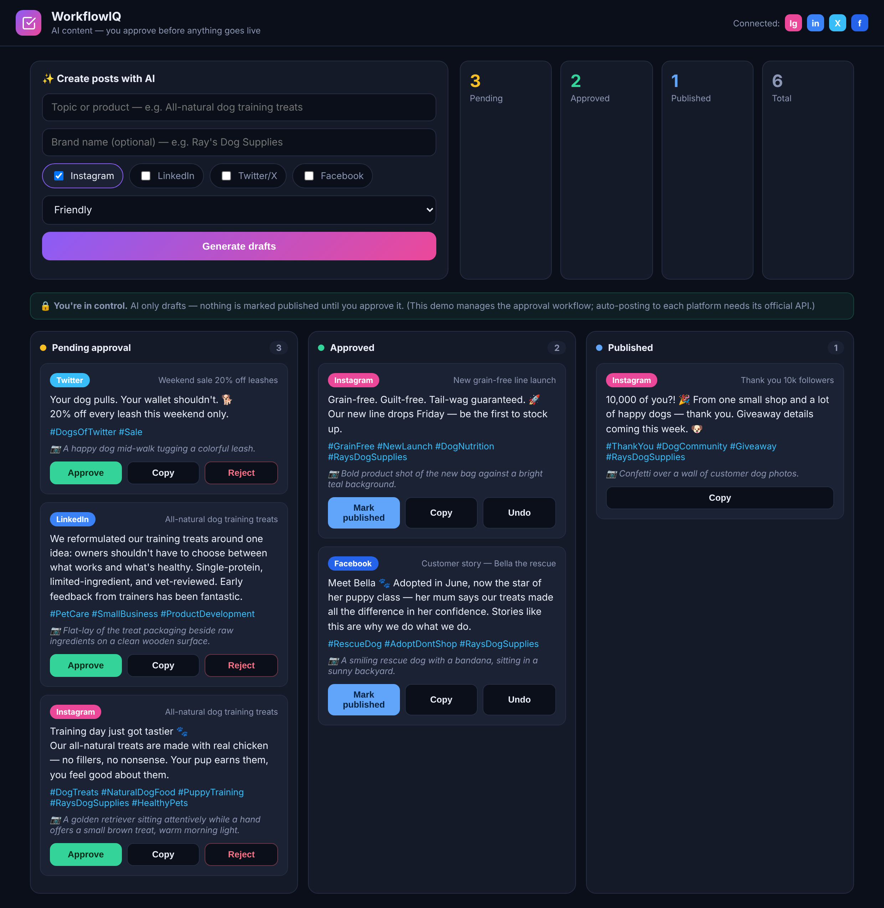

# WorkflowIQ — AI Content Approval & Publishing

Teams want social media posts fast, but nobody wants an AI posting to their brand's
account unsupervised. **WorkflowIQ** fixes that: AI drafts platform-specific posts,
then a human approves every one before it's marked ready to publish. Nothing goes
live without a person clicking **Approve**.



## What it does

- **Suggest today's idea** — one tap looks at what you've already posted and
  proposes a *fresh* topic, so you never stare at a blank box.
- **Generate** — pick platforms (Instagram, LinkedIn, Twitter/X, Facebook) and a
  tone. AI writes a caption + hashtags written *specifically for each platform*
  (LinkedIn reads professional, Twitter is punchy, etc.) — plus a real generated
  **image** for each.
- **Real images, free** — each post gets an actual generated photo via
  [Pollinations](https://pollinations.ai) (no API key, no cost). The AI also
  writes the image prompt, so you can regenerate or hand it to DALL·E for
  production quality.
- **Approval board** — every draft lands in **Pending approval**. You
  **Approve**, **Reject**, or hit **↻ New** to regenerate a draft you don't like
  (new text + new image). Approved posts move to **Approved**, then **Mark
  published** when you've posted them. Clean Pending → Approved → Published flow.
- **Copy to post** — one click copies the caption + hashtags, ready to paste.
- **Export to CSV** — download every post; opens straight in Excel.
- **Telegram alert** (optional) — pings you when new drafts are waiting.
- **Live stats** — counts by status and by platform.

## Honest note on "publishing"

This tool **drafts** posts (text + a real generated image) and **manages** a human
approval workflow. It does **not** auto-post to Instagram/Facebook/LinkedIn — that
requires each platform's official API (Meta Graph API, LinkedIn API), which is a
separate, per-client integration. Here an approved post is marked ready and you copy
it across. That keeps it safe and within each platform's terms. The approval workflow
is the real product; auto-posting is a bolt-on when a client wants it.

> Want the "Suggest idea" step to run **automatically every morning**? That's a
> scheduled job (cron) hitting `/api/generate` on a timer — easy to add once deployed.

## Tech

Python · FastAPI · Groq LLM (OpenAI-compatible API) · vanilla JS frontend.
Posts are stored in `posts.jsonl` (simple file store; swap for a database for
multi-user/persistent use).

## Run locally

```bash
python -m venv venv
# Windows: venv\Scripts\activate   |   Mac/Linux: source venv/bin/activate
pip install -r requirements.txt

# optional — without a key it uses template drafts so the UI still works
set GROQ_API_KEY=your_key_here          # Windows
# export GROQ_API_KEY=your_key_here     # Mac/Linux

uvicorn app:app --reload
```

Open http://localhost:8000

## Environment variables

| Variable | Purpose |
|---|---|
| `GROQ_API_KEY` | Groq API key. Without it, the app uses simple template drafts. |
| `GROQ_MODEL` | Model name (default `openai/gpt-oss-20b`). |
| `TELEGRAM_BOT_TOKEN` | Optional — Telegram bot token for "new drafts" alerts. |
| `TELEGRAM_CHAT_ID` | Optional — your Telegram chat ID. |

## Deploy (Render, free)

1. Push this folder to a GitHub repo.
2. New → Web Service → connect the repo.
3. Build: `pip install -r requirements.txt`
4. Start: `uvicorn app:app --host 0.0.0.0 --port $PORT`
5. Add the environment variables above.

> On Render's free tier the service sleeps after 15 min idle and the disk is
> ephemeral, so `posts.jsonl` resets on redeploy. Fine for a demo; use a hosted
> database (e.g. Supabase/Postgres) for anything persistent.

---

Part of a suite of AI automation tools. Built by Mohit Kumar.
